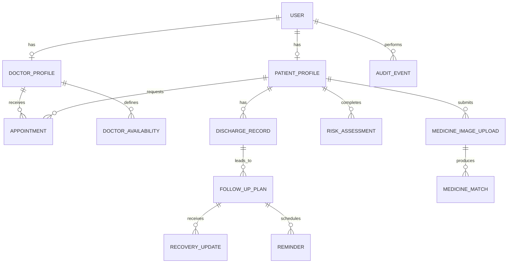

# Database Design – Initial Conceptual Model

**Status:** Conceptual only. Final database choice and schema are TBD.

## 1. Candidate entities
- User
- PatientProfile
- DoctorProfile
- Appointment
- DoctorAvailability
- DischargeRecord
- FollowUpPlan
- RecoveryUpdate
- Reminder
- RiskAssessment
- MedicineImageUpload
- MedicineMatch
- AuditEvent

## 2. Conceptual relationships

## 3. Important design notes
- Store role and permission information so that a user cannot grant themselves privileges.
- Use stable identifiers and timestamps.
- Keep uploaded image binaries in private object storage rather than directly in ordinary profile documents.
- Store model name/version and assessment timestamp with each risk result.
- Record the source and version/date of medicine reference data used for matching.
- Minimize collected health data; define purpose, retention, deletion, and access rules.
- Do not expose patient records to hospital management by default; aggregate-only access is the provisional privacy-preserving assumption pending approval.

## 4. Schema details to decide
- MongoDB versus PostgreSQL.
- Whether a patient may have multiple simultaneous pending appointment requests.
- Whether one appointment can involve more than one clinician.
- Hospital/clinic tenancy model.
- Retention and deletion rules.
- Consent and contact preference representation.
