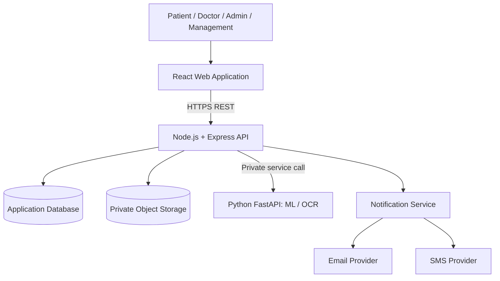

# High-Level Design (HLD)

**Status:** Preliminary architecture proposal; not yet baselined.

## 1. Proposed architecture
- React frontend for patient, doctor, administrator, and management experiences.
- Node.js/Express backend as the primary application API and business-logic layer.
- MongoDB as the provisional persistence layer.
- Python/FastAPI service for ML and OCR workloads.
- External email and SMS providers behind notification adapters.
- Object storage for uploaded images, subject to access controls, malware checks, and retention policy.

## 2. Logical component diagram

## 3. Architectural principles
- Begin with a modular monolith for core application functions; do not split every module into a microservice.
- Keep ML/OCR workloads in a separate Python service because of the Python ecosystem.
- Enforce authorization in the backend, not only in the frontend.
- Use private storage and short-lived authorized access for uploaded files.
- Keep notification delivery asynchronous and retryable.
- Version model artifacts and record which model version produced an assessment.
- Maintain audit events for sensitive operations.

## 4. Suggested backend modules
- Identity and access
- User and profile management
- Doctor directory and availability
- Appointment management
- Discharge and follow-up
- Risk assessment
- Medicine image processing
- Notifications
- Audit and reporting

## 5. Key flows
### Appointment request
React → API → validate patient/doctor/slot → persist pending request → notify doctor → doctor decision → persist decision → notify patient.

### Risk assessment
React → API → validate inputs and consent → ML service → validate response → persist result/model version → display with limitations.

### Medicine image
React → API → validate upload → private object storage → OCR/matching service → possible matches or inconclusive result → display verification warning.

## 6. Reliability and security
- HTTPS/TLS for external communication.
- Service-to-service authentication for internal ML calls.
- Least-privilege database and storage access.
- Rate limiting and input validation.
- Idempotency and concurrency protection for appointment decisions.
- Retry queues and dead-letter handling for notifications.
- Backups and tested restoration procedures.
- Secrets held in environment/secret management, never committed to Git.

## 7. Decisions still open
See `DECISION_LOG.md`. Database choice, deployment topology, provider selection, and clinical/model requirements must be reviewed before architecture approval.
