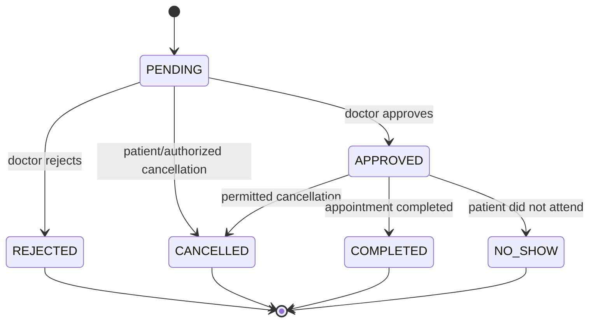

# Low-Level Design (LLD)

**Status:** Starter design; detailed contracts are TBD.

## 1. Appointment state model

Only authorized actors may perform transitions. Every transition must be validated against the current state and recorded with actor, timestamp, and reason where appropriate.

## 2. Appointment approval algorithm (conceptual)
1. Authenticate doctor.
2. Verify doctor is assigned to the request.
3. Verify request status is `PENDING`.
4. Start database transaction or use an equivalent atomic concurrency-control strategy.
5. Re-check that the selected slot is eligible and not occupied by another confirmed appointment.
6. Update request to `APPROVED`.
7. Commit.
8. Enqueue patient notification.
9. If validation fails, return a conflict response without confirming the appointment.

The exact transaction/index strategy depends on the selected database.

## 3. Follow-up reminder workflow
1. Clinician creates a follow-up plan.
2. System validates patient association, due date, contact details, and applicable consent/preferences.
3. System creates reminder jobs for email and SMS.
4. Worker sends each reminder through its provider adapter.
5. System records attempt, provider response, and retry state.
6. Failed delivery is visible to operations; it does not silently delete the follow-up plan.

## 4. Medicine-image processing workflow
1. Validate file size, extension, MIME type, and actual file signature.
2. Reject unsupported or suspicious files.
3. Store privately with a generated object key.
4. Run OCR and extract text such as product name, strength, manufacturer, and batch/expiry details where legible.
5. Match against an approved medicine reference source.
6. Return candidates with evidence and uncertainty.
7. If evidence is insufficient, return `INCONCLUSIVE`.
8. Never infer dose or advise use from the image.

## 5. Error handling
Use consistent API error responses with a machine-readable code, safe user-facing message, and correlation ID. Do not expose stack traces, secrets, or patient data in error messages.
