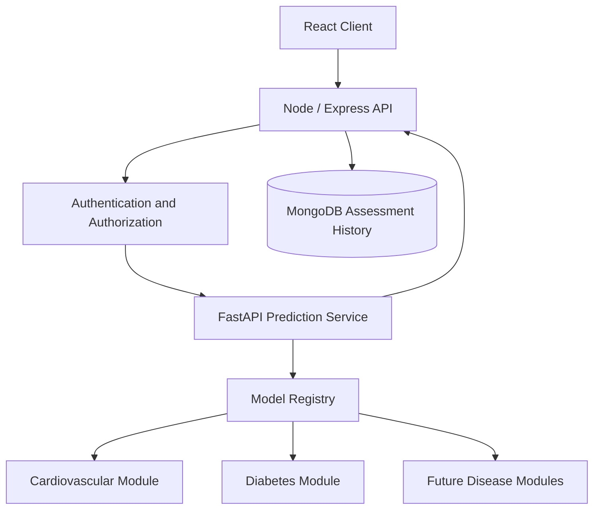

# SwasthyaCare — Disease Prediction & Extensible ML Sprint Planner

**Document ID:** SWC-ML-SP-001  
**Version:** 1.0  
**Status:** Proposed implementation baseline  
**Database decision:** MongoDB selected  
**Planning model:** Agile Scrum with incremental delivery  
**Sprint duration:** 2 weeks  
**Planned roadmap:** 6 sprints / approximately 12 weeks  
**Project:** SwasthyaCare — Healthcare Assistance and Patient Risk Assessment System

---

## 1. Purpose

This sprint planner converts the SwasthyaCare intelligent-feature requirements into an actionable ML engineering roadmap.

It defines:

- Disease prediction scope and target definitions.
- Dataset selection and audit.
- Sprint goals, tasks, dependencies, and acceptance criteria.
- Data preparation, model training, and evaluation.
- Extensible architecture for adding diseases in future.
- FastAPI and Express integration.
- MongoDB assessment-history direction.
- Testing, safety, and release expectations.
- Definition of Ready and Definition of Done.
- The exact work to begin in ML Sprint 1.

This is a planning baseline. Sprint scope can be adjusted after each review, but changes must be recorded in the backlog and decision log.

## 2. Confirmed project decisions and proposed ML decisions

| Area | Decision |
|---|---|
| SDLC model | Agile Scrum with incremental development |
| Database | **MongoDB** |
| Frontend | React |
| Main backend | Node.js + Express |
| ML service | Python + FastAPI |
| Initial disease features | Cardiovascular disease and diabetes |
| Future expansion | New disease modules can be added independently |
| Development/demo data | Synthetic or properly de-identified data |
| Initial model purpose | Educational/prototype classification, not clinical diagnosis |
| Model framework | Scikit-learn baseline; additional libraries only when justified |
| Model persistence | Versioned fitted pipelines and model metadata |

### 2.1 Why start with cardiovascular disease and diabetes?

These two areas were already included in the SwasthyaCare project requirements. They provide two concrete workflows to develop the data science and ML engineering lifecycle.

They also provide useful learning challenges:

- Cardiovascular dataset: small benchmark dataset, feature interpretation, generalization and overfitting concerns.
- Diabetes indicators dataset: larger survey dataset, class imbalance, target interpretation and probability calibration.

The choice is for an initial project prototype. It is not a claim that these are the most important diseases or that the selected public datasets are clinically suitable for deployment.

### 2.2 Initial prediction targets — critical distinction

**Cardiovascular prototype**

The commonly used UCI Cleveland Heart Disease dataset can support a classification exercise for the presence of heart disease as defined by its target labels. It does not establish a validated 10-year cardiovascular risk score.

**Diabetes prototype**

The UCI CDC Diabetes Health Indicators dataset contains survey-derived health indicators and reported diabetes-status labels. It does not necessarily predict future diabetes onset.

The product must use wording that accurately reflects these targets. Do not label either output as a diagnosis or as a clinically validated risk score.

### 2.3 Dataset candidates

| Model | Candidate dataset | Characteristics | Initial prototype target |
|---|---|---|---|
| Cardiovascular | UCI Heart Disease — Cleveland subset | Commonly used subset has 303 records and 13 predictors | Dataset-defined heart-disease presence |
| Diabetes | UCI CDC Diabetes Health Indicators | 253,680 records and 21 features | Survey-reported diabetes status |

Official dataset references:

- UCI Heart Disease: https://archive.ics.uci.edu/dataset/45/heart+disease
- UCI CDC Diabetes Health Indicators: https://archive.ics.uci.edu/dataset/891/cdc+diabetes+health+indicators
- WHO cardiovascular risk management guidance: https://www.who.int/publications/i/item/9789240001367

Dataset descriptions, licenses, provenance, target definitions, and permitted uses must be checked before use. Neither dataset should be assumed to represent Indian patients.

---

## 3. Proposed 12-week roadmap

| Sprint | Duration | Goal | Main deliverable |
|---|---|---|---|
| ML Sprint 1 | Weeks 1–2 | Problem definition and dataset audit | Approved problem definitions, dataset cards and data dictionary |
| ML Sprint 2 | Weeks 3–4 | EDA and preprocessing | Reproducible preprocessing pipelines and EDA report |
| ML Sprint 3 | Weeks 5–6 | Baseline model training | Candidate models and experiment comparison |
| ML Sprint 4 | Weeks 7–8 | Evaluation and model selection | Evaluation report, model cards and versioned artifacts |
| ML Sprint 5 | Weeks 9–10 | Extensible FastAPI service and Express integration | Model registry and versioned inference APIs |
| ML Sprint 6 | Weeks 11–12 | Frontend integration, testing and release | End-to-end disease-assessment prototype |

The schedule is a planning estimate, not a guarantee. A sprint may be extended if its acceptance criteria are not met.

---

# 4. Detailed sprint plans

## ML Sprint 1 — Problem definition and dataset audit

**Duration:** 2 weeks  
**Priority:** Critical  
**Sprint goal:** Define precisely what each model predicts, verify the selected datasets, and document their limitations before training begins.

### Tasks

| ID | Task | Priority | Expected result |
|---|---|---|---|
| ML1-01 | Write a problem statement for cardiovascular classification | Must | Target, intended use and exclusions documented |
| ML1-02 | Write a problem statement for diabetes classification | Must | Target, intended use and exclusions documented |
| ML1-03 | Download official dataset files and documentation | Must | Reproducible local dataset copies |
| ML1-04 | Review dataset license and permitted use | Must | Usage decision recorded |
| ML1-05 | Inspect row count, columns, data types and target values | Must | Initial dataset profile |
| ML1-06 | Create a data dictionary with definitions and units | Must | Feature reference |
| ML1-07 | Identify missing, duplicate and invalid values | Must | Data-quality summary |
| ML1-08 | Check for target leakage and post-outcome features | Must | Leakage review |
| ML1-09 | Record population, collection method and known limitations | Must | Dataset cards |
| ML1-10 | Agree on accurate user-facing prediction wording | Must | Approved output wording |

### Acceptance criteria

- Dataset source, version and license are recorded.
- Every target label is understood and documented.
- Feature definitions and units are available.
- Missing values, duplicates and suspicious values are quantified.
- Potential leakage is investigated.
- Dataset limitations and population mismatch are documented.
- Product wording does not claim future disease risk if the target represents existing/reported status.
- Raw datasets are kept out of public source control unless redistribution is explicitly permitted.

### Sprint 1 deliverable

A reviewed dataset audit package containing two dataset cards, two problem definitions, and a data dictionary.

---

## ML Sprint 2 — Data cleaning and exploratory data analysis

**Duration:** 2 weeks  
**Sprint goal:** Understand data quality, explore feature distributions, and create reproducible preprocessing pipelines.

### Tasks

| ID | Task | Priority | Expected result |
|---|---|---|---|
| ML2-01 | Create a cardiovascular EDA notebook | Must | Reproducible notebook |
| ML2-02 | Create a diabetes EDA notebook | Must | Reproducible notebook |
| ML2-03 | Analyze target/class distribution | Must | Class-balance summary |
| ML2-04 | Analyze numerical feature distributions | Must | Distribution plots and summary statistics |
| ML2-05 | Analyze categorical feature frequencies | Must | Category summaries |
| ML2-06 | Inspect missing and invalid values | Must | Data-quality report |
| ML2-07 | Inspect duplicates and unusual observations | Must | Documented decisions |
| ML2-08 | Examine feature relationships and possible leakage | Must | Correlation/association review |
| ML2-09 | Define train/validation/test strategy | Must | Reproducible split plan |
| ML2-10 | Build preprocessing pipelines | Must | Reusable transformers |
| ML2-11 | Document transformations and exclusions | Must | Preprocessing specification |

### Engineering rules

1. Split data before fitting preprocessing steps.
2. Fit imputers, scalers and encoders on training data only.
3. Use stratified splitting for classification where appropriate.
4. Keep a final test set untouched until candidate selection is complete.
5. Perform cross-validation only within the training data.
6. Apply resampling or class weighting only within training folds.
7. Never use the test set to select features, thresholds or hyperparameters.
8. Document every exclusion and transformation.
9. Preserve a reproducible mapping from raw input columns to model features.

### Acceptance criteria

- EDA can be rerun from documented notebooks/scripts.
- No unexplained rows are silently dropped.
- Target leakage checks are documented.
- Preprocessing can be applied consistently to new inputs.
- Class imbalance and its implications are understood.
- The final test set remains isolated.
- Data preparation steps are version-controlled without committing restricted raw data.

### Sprint 2 deliverable

Reproducible EDA notebooks, preprocessing pipelines, and a data-quality report.

---

## ML Sprint 3 — Baseline model training

**Duration:** 2 weeks  
**Sprint goal:** Train and compare multiple candidate algorithms using consistent, reproducible experiments.

### Candidate algorithms

| Algorithm | Purpose |
|---|---|
| Logistic Regression | Interpretable baseline |
| Decision Tree | Simple rule-based comparison |
| Random Forest | Nonlinear ensemble candidate |
| Gradient Boosting / XGBoost | Additional tabular-data candidate |
| Support Vector Machine | Optional comparison |

Start with Logistic Regression, Decision Tree, and Random Forest. Add XGBoost or another algorithm only if it is appropriate for the dataset and can be evaluated fairly. A more complex model is not automatically a better model.

### Tasks

| ID | Task | Priority | Expected result |
|---|---|---|---|
| ML3-01 | Create reusable training pipeline | Must | Shared experiment structure |
| ML3-02 | Train Logistic Regression baseline | Must | Baseline metrics |
| ML3-03 | Train Decision Tree | Must | Candidate metrics |
| ML3-04 | Train Random Forest | Must | Candidate metrics |
| ML3-05 | Train Gradient Boosting/XGBoost if suitable | Should | Additional candidate |
| ML3-06 | Tune hyperparameters using training data only | Must | Documented tuning results |
| ML3-07 | Compare cross-validation results | Must | Model comparison table |
| ML3-08 | Record random seeds and package versions | Must | Reproducibility metadata |
| ML3-09 | Save experiment results | Must | Experiment log |
| ML3-10 | Save candidate pipelines including preprocessing | Must | Candidate artifacts |

### Acceptance criteria

- Candidate models use the same documented split strategy.
- Preprocessing is included in each fitted pipeline.
- Cross-validation does not touch the final test set.
- Random seeds and software versions are recorded.
- Experiments can be reproduced.
- Model selection is not based solely on training accuracy.
- Results are reported separately for the two disease targets.

### Sprint 3 deliverable

Candidate model pipelines, experiment logs, and a baseline comparison report.

---

## ML Sprint 4 — Evaluation, explainability and model selection

**Duration:** 2 weeks  
**Priority:** Critical  
**Sprint goal:** Evaluate model quality, understand errors and limitations, and select a prototype model only when the evidence supports it.

### Metrics to report

| Metric | Why it matters |
|---|---|
| Confusion matrix | Shows true/false positives and negatives |
| Recall / sensitivity | Proportion of positive cases detected |
| Specificity | Proportion of negative cases correctly identified |
| Precision | Proportion of positive predictions that are correct |
| F1-score | Combines precision and recall |
| ROC-AUC | Measures ranking discrimination across thresholds |
| PR-AUC | Useful when positive cases are relatively uncommon |
| Calibration | Checks whether predicted probabilities correspond to observed frequencies |

Accuracy alone is not enough, especially when classes are imbalanced.

### Tasks

| ID | Task | Priority | Expected result |
|---|---|---|---|
| ML4-01 | Evaluate candidate models on validation data | Must | Validation report |
| ML4-02 | Generate confusion matrices | Must | Error visualizations |
| ML4-03 | Calculate recall, specificity, precision and F1 | Must | Classification metrics |
| ML4-04 | Calculate ROC-AUC and PR-AUC where appropriate | Must | Discrimination metrics |
| ML4-05 | Assess probability calibration if probabilities are exposed | Must | Calibration report |
| ML4-06 | Analyze false positives and false negatives | Must | Error analysis |
| ML4-07 | Review subgroup performance where data supports it | Must | Subgroup limitations/results |
| ML4-08 | Add interpretable feature analysis | Should | Explainability summary |
| ML4-09 | Select candidate and document rationale | Must | Model-selection record |
| ML4-10 | Evaluate once on untouched test data | Must | Final test report |
| ML4-11 | Write a model card for each model | Must | Intended-use and limitations record |

### Acceptance criteria

- Metrics are computed on data not used to fit the model.
- The final test set is used only after candidate selection.
- False-positive and false-negative implications are discussed.
- Calibration is assessed if probabilities are displayed.
- Subgroup results are reported where sample sizes and data quality permit.
- No threshold is presented as a clinical decision threshold without qualified clinical input.
- Model cards state intended use, prohibited use, population limitations and dataset provenance.
- If evidence is inadequate, the model remains experimental and is not exposed as an active patient-facing feature.

### Sprint 4 deliverable

Evaluation report, model cards, model-selection records, and approved versioned prototype artifacts.

---

## ML Sprint 5 — Extensible FastAPI service and Express integration

**Duration:** 2 weeks  
**Sprint goal:** Build a disease-independent service framework that can serve separate disease-specific models and can be extended without rewriting the entire ML service.

### Proposed architecture



### Proposed service endpoints

| Method | Endpoint | Purpose |
|---|---|---|
| GET | `/health` | Service health |
| GET | `/v1/models` | List approved model identifiers and versions |
| POST | `/v1/predictions/cardiovascular` | Cardiovascular prototype inference |
| POST | `/v1/predictions/diabetes` | Diabetes-status prototype inference |

The routes are internal ML-service endpoints. Public application requests should go through Express, which enforces user authentication and authorization.

### Tasks

| ID | Task | Priority | Expected result |
|---|---|---|---|
| ML5-01 | Create Python FastAPI service structure | Must | Independently running service |
| ML5-02 | Define shared response contract | Must | Consistent response envelope |
| ML5-03 | Define disease-specific Pydantic request schemas | Must | Strict input validation |
| ML5-04 | Create model registry abstraction | Must | Model metadata and approved artifact lookup |
| ML5-05 | Implement model loading/version selection | Must | Versioned model loading |
| ML5-06 | Add cardiovascular prediction module | Must | Cardiovascular inference route |
| ML5-07 | Add diabetes prediction module | Must | Diabetes inference route |
| ML5-08 | Add health/readiness checks | Must | Service status endpoints |
| ML5-09 | Connect Express backend to FastAPI | Must | Authenticated service integration |
| ML5-10 | Add timeout and controlled failure handling | Must | Safe failure behavior |
| ML5-11 | Add API and integration tests | Must | Contract and service tests |
| ML5-12 | Document the process for registering a future disease | Must | Extension guide |

### Proposed shared response envelope

```json
{
  "model_id": "cardiovascular-prototype",
  "model_version": "1.0.0",
  "prediction": 1,
  "probability": 0.42,
  "output_label": "positive_class",
  "limitations": [
    "Educational prototype only",
    "Not a medical diagnosis"
  ]
}
```

The numeric values are illustrative only. The final response must reflect the selected model's actual output and calibration evidence. A probability must not be returned as a clinically meaningful risk unless that interpretation is supported.

### Acceptance criteria

- FastAPI runs independently from Express.
- Each disease route validates input against its own schema.
- Correct approved model artifact and version are loaded.
- The shared response envelope is consistent across disease modules.
- Disease-specific outputs and limitations remain explicit.
- Express authorizes the user before forwarding an inference request.
- FastAPI is not exposed to untrusted clients without appropriate security.
- Timeout or model failure returns a controlled error, never a fabricated prediction.
- Model artifacts are versioned and integrity-checked.
- A future disease can be added by implementing its schema, preprocessing/model artifact, registry entry, route/module and tests without modifying unrelated disease modules.

### Sprint 5 deliverable

An extensible FastAPI inference service with a model registry, two disease modules, Express integration and a documented future-disease onboarding process.

---

## ML Sprint 6 — Frontend integration, MongoDB history and end-to-end QA

**Duration:** 2 weeks  
**Sprint goal:** Integrate the disease assessment workflows into SwasthyaCare and verify safe end-to-end behavior.

### Tasks

| ID | Task | Priority | Expected result |
|---|---|---|---|
| ML6-01 | Design cardiovascular assessment form | Must | Disease-specific form |
| ML6-02 | Design diabetes assessment form | Must | Disease-specific form |
| ML6-03 | Add units, definitions and input help | Must | Understandable input fields |
| ML6-04 | Add client-side validation for usability | Must | Early feedback |
| ML6-05 | Add Express application endpoints | Must | Authenticated public API |
| ML6-06 | Connect forms to Express endpoints | Must | Working submission flow |
| ML6-07 | Display model output and limitations | Must | Transparent result view |
| ML6-08 | Add loading, error and unavailable states | Must | Safe user feedback |
| ML6-09 | Store permitted assessment metadata in MongoDB | Must | Assessment history |
| ML6-10 | Add patient-history access controls | Must | Patient-specific authorization |
| ML6-11 | Test unauthorized and cross-patient access | Must | Access-control tests |
| ML6-12 | Test invalid inputs and ML-service outage | Must | Failure-path coverage |
| ML6-13 | Test model version and history display | Must | Traceable results |
| ML6-14 | Update technical and user documentation | Must | Release documentation |

### Proposed MongoDB collection

Use a common `riskAssessments` collection for assessment metadata, with a disease identifier and model version.

Example document:

```json
{
  "_id": "generated-object-id",
  "patientId": "patient-object-id",
  "assessmentType": "cardiovascular",
  "modelId": "cardiovascular-prototype",
  "modelVersion": "1.0.0",
  "prediction": 1,
  "probability": 0.42,
  "createdAt": "2026-11-10T06:30:00.000Z"
}
```

This is illustrative. Use actual MongoDB ObjectIds, validated enums, timestamps and the final API contract. Do not retain raw clinical inputs by default; document a purpose, access policy and retention period before storing them.

### Acceptance criteria

- A patient can submit the defined assessment form.
- Express authenticates and authorizes the request.
- The correct disease-specific schema and model are invoked.
- Result identifies model and version and explains limitations.
- Patient can view only their own permitted assessment history.
- An unavailable model service does not display a stale or fabricated prediction.
- Errors do not expose stack traces or sensitive data.
- UI does not diagnose, prescribe or advise medication changes.
- The two disease modules can be tested independently.
- A documented future-disease addition path is demonstrated at architecture/test level.

### Sprint 6 deliverable

An integrated disease-assessment prototype with two independent model modules, MongoDB assessment history, and an extensible service architecture.

---

# 5. Future disease expansion strategy

The platform must be shared, while each disease model remains independent.

| Component | Shared or disease-specific? |
|---|---|
| Authentication and authorization | Shared in Express |
| FastAPI service infrastructure | Shared |
| Model registry | Shared |
| Common response envelope | Shared |
| Assessment history collection | Shared, with assessment type |
| Dataset | Disease-specific |
| Target definition | Disease-specific |
| Input schema and feature definitions | Disease-specific |
| Preprocessing pipeline | Disease-specific |
| Trained model | Disease-specific |
| Evaluation report and model card | Disease-specific |
| Clinical validation | Disease-specific |

### 5.1 Process for adding a future disease

Example: adding a Chronic Kidney Disease (CKD) prototype.

1. Define the exact task: existing CKD classification, future risk prediction, or screening support. These are not interchangeable.
2. Identify a suitable dataset and review its license, provenance, population and target.
3. Create a dataset card, data dictionary and problem definition.
4. Build disease-specific EDA and preprocessing.
5. Train and evaluate candidate models independently.
6. Create a model card and document limitations.
7. Add a disease-specific Pydantic schema and inference module.
8. Register the approved model identifier, version and artifact.
9. Add the corresponding Express route and frontend workflow.
10. Add MongoDB assessment metadata and access-control tests.
11. Complete the appropriate clinical/safety review before enabling real-world use.

A new disease must not reuse the cardiovascular or diabetes model just because the input fields appear similar.

### 5.2 Model registry example

```python
MODEL_REGISTRY = {
    "cardiovascular": {
        "version": "1.0.0",
        "status": "active",
        "artifact": "models/cardiovascular/v1/model.joblib"
    },
    "diabetes": {
        "version": "1.0.0",
        "status": "active",
        "artifact": "models/diabetes/v1/model.joblib"
    },
    "kidney": {
        "version": None,
        "status": "not_registered",
        "artifact": None
    }
}
```

This is a conceptual example, not production-ready code. The real registry must validate entries, restrict loading to approved artifacts, verify integrity, and distinguish development, validated, active and retired states. A model should not be marked active solely because an artifact exists.

---

# 6. Product backlog and priority

Use these priority labels:

- **P0 — Must:** Required for the ML foundation and safe prototype.
- **P1 — Should:** Important for the intended demonstration.
- **P2 — Could:** Add only if time and capacity permit.

| Backlog ID | Feature | Priority | Planned sprint |
|---|---|---|---|
| ML-PB-01 | Define cardiovascular target and intended use | P0 | 1 |
| ML-PB-02 | Define diabetes target and intended use | P0 | 1 |
| ML-PB-03 | Dataset license and quality audit | P0 | 1 |
| ML-PB-04 | Data dictionary and dataset cards | P0 | 1 |
| ML-PB-05 | EDA for both datasets | P0 | 2 |
| ML-PB-06 | Reproducible preprocessing pipelines | P0 | 2 |
| ML-PB-07 | Train baseline classifiers | P0 | 3 |
| ML-PB-08 | Compare candidate models | P0 | 3 |
| ML-PB-09 | Evaluation and calibration analysis | P0 | 4 |
| ML-PB-10 | Model cards and versioned artifacts | P0 | 4 |
| ML-PB-11 | FastAPI service foundation | P0 | 5 |
| ML-PB-12 | Shared model registry | P0 | 5 |
| ML-PB-13 | Cardiovascular inference module | P0 | 5 |
| ML-PB-14 | Diabetes inference module | P0 | 5 |
| ML-PB-15 | Future disease onboarding guide | P1 | 5 |
| ML-PB-16 | Express-to-FastAPI integration | P0 | 5 |
| ML-PB-17 | Disease assessment forms | P0 | 6 |
| ML-PB-18 | MongoDB assessment history | P0 | 6 |
| ML-PB-19 | Patient history authorization | P0 | 6 |
| ML-PB-20 | End-to-end and failure-path tests | P0 | 6 |
| ML-PB-21 | Future CKD module | P2 | Future release |
| ML-PB-22 | Future respiratory module | P2 | Future release |

Priorities describe the proposed project release, not clinical importance. A feature must be deferred if its data, evaluation or safety prerequisites are not met.

---

# 7. Definition of Ready (DoR)

An ML backlog item can enter a sprint when:

- Its user or engineering value is understood.
- The prediction target and intended use are defined.
- Dataset source and license are known for data tasks.
- Feature definitions and units are available.
- Acceptance criteria are written.
- Dependencies are known.
- Data leakage risks have been considered.
- Evaluation and test approach is understood.
- The task is small enough to complete within the sprint or has been split.

# 8. Definition of Done (DoD)

An ML task is complete only when:

- Code is implemented and reviewed.
- Training and preprocessing are reproducible where applicable.
- Relevant unit/integration tests pass.
- Data splits and evaluation are correctly separated.
- Model artifacts and versions are recorded.
- API validation and backend authorization are implemented.
- Error and loading behavior is handled.
- No secrets or unnecessary sensitive data are committed or logged.
- Documentation is updated.
- Changes are merged through the agreed Git workflow.
- Acceptance criteria are demonstrated.

For healthcare-related features, intended use, uncertainty, known limitations and data-handling requirements must be reflected in the UI and documentation.

---

# 9. Scrum operating rhythm

For each two-week sprint:

| Event | Suggested cadence | Purpose |
|---|---|---|
| Sprint planning | First day | Select achievable work and define sprint goal |
| Daily check-in | 10–15 minutes on workdays | Share progress, next task and blockers |
| Backlog refinement | Once per week | Clarify and prepare upcoming work |
| Sprint review | Final day | Demonstrate completed functionality |
| Sprint retrospective | Final day | Identify process improvements |

For a solo student project, ceremonies can be lightweight. Maintain a task board with `Backlog`, `Ready`, `In Progress`, `In Review`, `Testing`, and `Done`.

---

# 10. Suggested repository structure

```text
swasthyacare/
├── client/
├── server/
├── ai-service/
│   ├── app/
│   │   ├── main.py
│   │   ├── routes/
│   │   │   ├── health.py
│   │   │   └── predictions.py
│   │   ├── registry/
│   │   │   └── model_registry.py
│   │   ├── schemas/
│   │   │   ├── common.py
│   │   │   ├── cardiovascular.py
│   │   │   └── diabetes.py
│   │   └── services/
│   │       └── prediction_service.py
│   ├── disease_modules/
│   │   ├── cardiovascular/
│   │   │   ├── preprocessing.py
│   │   │   └── inference.py
│   │   └── diabetes/
│   │       ├── preprocessing.py
│   │       └── inference.py
│   ├── training/
│   │   ├── cardiovascular/
│   │   └── diabetes/
│   ├── artifacts/
│   │   ├── cardiovascular/
│   │   └── diabetes/
│   ├── notebooks/
│   ├── tests/
│   └── requirements.txt
└── docs/
    └── ml/
        ├── problem_definitions.md
        ├── data_dictionary.md
        ├── cardiovascular_dataset_card.md
        ├── diabetes_dataset_card.md
        ├── eda_report.md
        ├── baseline_model_report.md
        ├── model_evaluation_report.md
        ├── cardiovascular_model_card.md
        ├── diabetes_model_card.md
        ├── inference_api.md
        └── adding_a_new_disease.md
```

Do not commit large raw datasets, private patient information, model secrets or unreviewed artifacts to a public repository. Use `.gitignore` and an approved artifact/data storage location.

---

# 11. MongoDB implementation direction

## 11.1 Proposed collection

Use the existing project collection name `riskAssessments` for assessment history.

Potential fields:

- `patientId`
- `assessmentType`
- `modelId`
- `modelVersion`
- `prediction`
- `probability` only where appropriately calibrated and approved for display
- `createdAt`
- `requestedBy` or audit metadata where required

Do not retain raw clinical inputs by default. Document purpose, access controls and retention before storing them.

## 11.2 MongoDB engineering rules

1. Use the same MongoDB access approach as the existing Express backend.
2. Define schema validation and required fields.
3. Add indexes based on actual query patterns, such as patient and creation date.
4. Use validated enums for assessment type and status.
5. Store timestamps consistently in UTC.
6. Enforce patient-specific access in the backend, not only in the frontend.
7. Shape API responses; do not expose raw MongoDB documents.
8. Keep audit metadata appropriate and avoid logging sensitive input values.

---

# 12. Safety, privacy and responsible-use requirements

SwasthyaCare's disease-prediction features are educational prototypes unless and until appropriate clinical validation and review have been completed.

- A prediction is not a diagnosis.
- Do not tell users to start, stop or change medication.
- Do not use model output as the sole basis for clinical decisions.
- Do not imply that a low model score means a person is healthy or safe.
- Do not invent probability thresholds or clinical risk categories.
- Use synthetic or properly de-identified data during development.
- Evaluate relevant subgroups where sample size and data quality permit.
- Record dataset population mismatch and known limitations.
- Obtain qualified clinical input before real-world clinical use.
- Review applicable privacy, security and regulatory obligations before processing real patient data.
- If the model service is unavailable, show an unavailable/error state rather than an old or fabricated prediction.

---

# 13. Sprint tracking

| Sprint | Status | Start date | End date | Review notes |
|---|---|---|---|---|
| ML Sprint 1 — Problem definition and dataset audit | Not started | TBD | TBD | |
| ML Sprint 2 — EDA and preprocessing | Not started | TBD | TBD | |
| ML Sprint 3 — Baseline model training | Not started | TBD | TBD | |
| ML Sprint 4 — Evaluation and model selection | Not started | TBD | TBD | |
| ML Sprint 5 — Extensible API and integration | Not started | TBD | TBD | |
| ML Sprint 6 — Frontend integration and QA | Not started | TBD | TBD | |

---

# 14. Immediate next action

Start with **ML Sprint 1 — Problem Definition and Dataset Audit**.

1. Download the two candidate datasets from their official UCI pages.
2. Read their descriptions and licenses.
3. Load each dataset in a separate Jupyter notebook.
4. Inspect shape, columns, target labels, missing values and class balance.
5. Create dataset cards and a data dictionary.
6. Confirm the product output wording accurately describes what each dataset can support.
7. Review and accept the Sprint 1 deliverables before moving to preprocessing and model training.

**Current status:** ML Sprint 1 — Not started.

**Release rule:** Do not begin model training until the dataset audit and target definitions have been reviewed.

