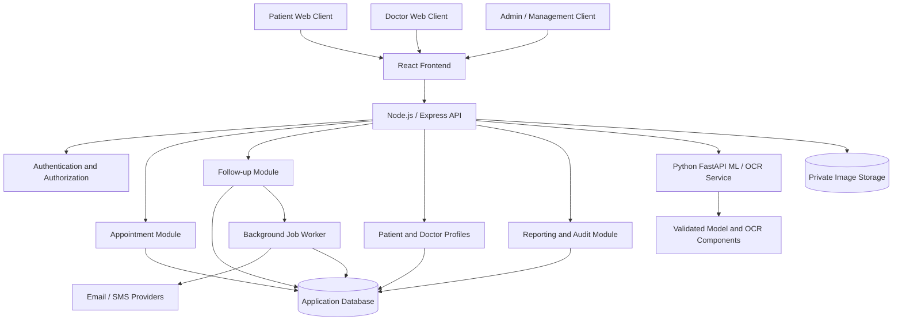

# SwasthyaCare — System Design Review (SDR)

**Document ID:** SWC-SDR-001  
**Version:** 0.1  
**Status:** Draft for review  
**Project:** SwasthyaCare — Healthcare Assistance and Patient Risk Assessment System  
**Prepared:** 9 November 2026

---

## 1. Purpose

This System Design Review (SDR) records the proposed technical design of SwasthyaCare before implementation begins. It is intended to verify that the proposed architecture, components, data model, interfaces, security controls, and operational approach are sufficiently clear and feasible.

This is a review draft, not an approval to deploy a clinical system. Decisions marked **TBD** must be confirmed by the project team before the affected implementation work starts.

## 2. Review objectives

The SDR will:

1. Confirm the system scope and major design constraints.
2. Review the proposed architecture and module boundaries.
3. Review the proposed data model and ownership of data.
4. Review API boundaries and communication between services.
5. Review authentication, authorization, privacy, and audit requirements.
6. Identify technical, operational, and clinical-safety risks.
7. Record decisions, open questions, and approval conditions.

## 3. Project scope

### 3.1 In-scope capabilities

- Patient registration, authentication, and profile management.
- Doctor discovery and appointment requests.
- Doctor review and approval or rejection of appointment requests.
- Doctor availability management.
- Post-discharge follow-up plans and patient recovery updates.
- Email and SMS reminders for follow-ups.
- Preliminary heart-disease and diabetes risk assessments.
- Medicine-package or medicine-strip image upload, OCR, and possible medicine matching.
- Doctor, admin, and hospital-management views with role-appropriate access.
- Audit logging for important actions.

### 3.2 Out of scope for the initial release

- Autonomous diagnosis or treatment recommendations.
- Automatic prescription generation or medication changes.
- Definitive medicine identification from an image without professional verification.
- Unsupervised clinical decision-making based solely on model output.
- Production integration with hospital systems unless separately approved.
- Use of identifiable patient data in development or demonstrations.

## 4. Users and roles

| Role | Primary responsibilities | Access principle |
|---|---|---|
| Patient | Manage own profile, request appointments, submit recovery updates, use supported assessment and medicine-image features | Access only own records |
| Doctor / authorized clinician | Manage availability, review appointment requests, create follow-up plans, review patient updates and assessment information | Access only patients and records permitted by assignment and workflow |
| Admin | Manage platform operations, users, configuration, and support functions | Administrative access does not automatically grant clinical-record access |
| Hospital management | View approved operational and aggregate reports | Aggregate-only access is the proposed privacy-preserving default; confirm before implementation |

Role names and exact permissions must be finalized in an access-control matrix.

## 5. Proposed architecture

### 5.1 Architecture style

**Proposed:** Modular monolith for the main application, with a separately deployable Python service for ML/OCR workloads.

This is a pragmatic starting point for a student project: it keeps the core application simpler to build and test while isolating model inference and image-processing dependencies.

### 5.2 Logical architecture

### 5.3 Component responsibilities

| Component | Proposed technology | Responsibility |
|---|---|---|
| Web client | React | Role-specific user interface and client-side validation |
| Main API | Node.js and Express | Business logic, request validation, authorization, and orchestration |
| Authentication | Express middleware and secure session/token approach | Identity verification and role enforcement |
| Application data | MongoDB (provisional) | Users, appointments, follow-ups, assessments, and audit metadata |
| ML/OCR service | Python and FastAPI | Risk-model inference and medicine-package OCR/matching |
| Private file storage | TBD | Store uploaded images with access restrictions |
| Background worker | TBD | Send scheduled reminders and retry failed notification jobs |
| Notification providers | TBD | Deliver email and SMS reminders |

**Architecture decision still open:** MongoDB is provisional, not final. The team must compare MongoDB with PostgreSQL before committing to the database implementation.

## 6. Module design

### 6.1 Authentication and authorization

Responsibilities:

- Register and authenticate users.
- Enforce role-based permissions on the server.
- Protect patient records from cross-user access.
- Support secure logout and session/token invalidation.
- Record security-relevant events.

Design rules:

- Never rely only on frontend route protection.
- Check authorization for every protected API operation.
- Store passwords using a modern password-hashing algorithm; never store plaintext passwords.
- Use secure transport (HTTPS) outside local development.
- Keep secrets out of source control.

### 6.2 Appointment management

Proposed flow:

1. Patient searches for a doctor and available appointment slots.
2. Patient submits an appointment request.
3. The request is created with status `PENDING`.
4. Doctor reviews the request.
5. Doctor approves or rejects it.
6. Patient receives the decision.
7. Approved appointments may later be completed, cancelled, or marked as no-show.

Proposed appointment statuses:

- `PENDING`
- `APPROVED`
- `REJECTED`
- `CANCELLED`
- `COMPLETED`
- `NO_SHOW`

Required safeguards:

- Prevent two approved appointments from occupying the same doctor slot.
- Enforce status transitions on the server.
- Record who performed each status change and when.
- Decide whether a pending request temporarily holds a slot and for how long (**TBD**).

### 6.3 Post-discharge follow-up

Responsibilities:

- An authorized clinician creates a follow-up plan.
- The plan includes due dates, instructions, and follow-up intervals.
- The system schedules email and SMS reminders.
- The patient can submit recovery updates.
- An authorized clinician reviews updates and records follow-up outcomes.

Safeguards:

- Reminders must not expose sensitive medical details in message previews.
- Failed reminders must be logged and retried according to a defined policy.
- A reminder is not proof that the patient received or acted on the message.
- The system must respect consent and applicable communication preferences.

### 6.4 Disease-risk assessment

Initial assessment areas:

- Heart-disease risk.
- Diabetes risk.

Proposed flow:

1. Collect only the input fields required by the approved model.
2. Validate ranges, types, and missing values.
3. Send the request to the Python inference service.
4. Return the model output with version and timestamp.
5. Display the result with clear limitations and an appropriate next step.
6. Permit authorized clinician review where included in the workflow.

Safety requirements:

- Results are preliminary risk estimates, not diagnoses.
- The interface must not imply certainty or replace professional evaluation.
- Model provenance, version, input schema, and validation status must be recorded.
- Models must be evaluated for performance and subgroup fairness before meaningful use.
- Do not use a model or dataset merely because it is available; document its suitability and limitations.

### 6.5 Medicine-package image assistance

Proposed flow:

1. Patient uploads an image of medicine packaging or a strip.
2. Backend validates file type, size, and upload authorization.
3. Image is stored in private storage.
4. Python service performs OCR and candidate matching against an approved reference source.
5. The system displays possible matches and confidence/uncertainty.
6. If the match is uncertain, the system says it could not identify the medicine reliably and recommends professional verification.

Safety requirements:

- The feature is an assistance tool, not definitive medicine identification.
- It must not instruct a patient to start, stop, or change a medicine.
- The source used for medicine matching must be selected, licensed/authorized as appropriate, and kept current.
- Uploaded images must not be publicly accessible.

## 7. Data design — preliminary entities

The following is a conceptual starting point. Exact fields, indexes, constraints, and relationships depend on the final database decision.

| Entity | Purpose | Important relationships |
|---|---|---|
| User | Identity and role information | May be linked to a patient or doctor profile |
| PatientProfile | Patient-specific profile data | Belongs to a user |
| DoctorProfile | Doctor details and professional information | Belongs to a user |
| AvailabilitySlot | Doctor's bookable availability | Belongs to a doctor |
| Appointment | Patient request and appointment lifecycle | References patient, doctor, and slot |
| FollowUpPlan | Post-discharge follow-up schedule | References patient and creating clinician |
| RecoveryUpdate | Patient-submitted progress information | References patient and follow-up plan |
| RiskAssessment | Assessment inputs, output, model version, and timestamp | References patient and requesting user |
| MedicineImageRecord | Image metadata and OCR/matching result | References patient and private image object |
| Notification | Reminder or status-notification delivery state | References recipient and relevant workflow item |
| AuditEvent | Security and business-action history | References actor and affected resource |

### 7.1 Data-design principles

- Apply least-privilege access to every collection/table and API.
- Separate identity/profile data from clinical or assessment data where practical.
- Avoid collecting fields that are not needed for a defined feature.
- Define retention and deletion rules before collecting real personal data.
- Use indexes for common lookups and enforce uniqueness/concurrency rules at the database layer.
- Keep uploaded medical images in private object storage rather than public web directories.
- Never put passwords, access tokens, or unnecessary clinical details in logs.

### 7.2 Database decision

**Current provisional choice:** MongoDB.

**Review required:** Compare with PostgreSQL using these criteria:

- Appointment-slot uniqueness and concurrent booking protection.
- Transaction and consistency requirements.
- Relationships between patients, doctors, appointments, and follow-ups.
- Query and reporting needs.
- Team familiarity, hosting, and operational complexity.

Do not finalize schemas or write database-specific repository code until this decision is approved.

## 8. API design — proposed boundaries

The following routes are illustrative API boundaries, not a finalized contract.

| Area | Example endpoint | Purpose |
|---|---|---|
| Authentication | `POST /api/auth/register` | Register a user |
| Authentication | `POST /api/auth/login` | Authenticate a user |
| Profile | `GET /api/patients/me` | Retrieve current patient's profile |
| Doctors | `GET /api/doctors` | Search doctors |
| Availability | `GET /api/doctors/:doctorId/slots` | View available slots |
| Appointments | `POST /api/appointments` | Submit an appointment request |
| Appointments | `GET /api/appointments/:id` | Retrieve an authorized appointment |
| Appointments | `PATCH /api/appointments/:id/status` | Approve or reject, subject to role and state rules |
| Follow-ups | `POST /api/follow-ups` | Create a follow-up plan as an authorized clinician |
| Follow-ups | `POST /api/follow-ups/:id/updates` | Submit a recovery update |
| Assessments | `POST /api/assessments/heart-risk` | Request a heart-risk estimate |
| Assessments | `POST /api/assessments/diabetes-risk` | Request a diabetes-risk estimate |
| Medicine assistance | `POST /api/medicine-images` | Upload packaging image for assistance |
| Audit | Internal service operation | Record relevant events; not a general patient-facing endpoint |

Every endpoint must define:

- Authentication requirement.
- Allowed roles and resource-level authorization.
- Request and response schema.
- Validation and error behavior.
- Rate limits and upload limits where applicable.
- Audit requirements.
- Whether the operation is idempotent or safe to retry.

## 9. Security, privacy, and safety design

Minimum design controls:

1. Enforce server-side authentication and authorization.
2. Hash passwords with a modern password-hashing algorithm.
3. Use HTTPS in deployed environments.
4. Validate and sanitize all untrusted input.
5. Restrict file uploads by type, size, and content inspection.
6. Store uploaded images privately and use short-lived authorized access where needed.
7. Protect secrets using environment-specific secret management.
8. Apply rate limits to authentication, upload, and inference endpoints.
9. Record audit events for sensitive record access and important changes.
10. Minimize personal data in logs, notifications, and analytics.
11. Define backup, restoration, retention, and deletion procedures.
12. Use synthetic or properly de-identified data for development and demonstrations.

A production clinical deployment requires appropriate clinical validation, privacy/security assessment, and review of applicable legal and regulatory obligations. This student-project design does not establish regulatory compliance.

## 10. Reliability and operational design

- API errors should use a consistent response structure.
- Background notifications should support retries and duplicate prevention.
- Appointment approval must be concurrency-safe.
- ML/OCR calls need timeouts and controlled failure responses.
- A failure in the ML/OCR service must not make unrelated appointment features unavailable.
- Health checks should distinguish application availability from dependency availability.
- Logs should support debugging without exposing unnecessary sensitive information.
- Backups and restore tests must be defined before any real data is stored.

## 11. Testing strategy

| Test level | What to verify |
|---|---|
| Unit | Validation, status transitions, permission checks, calculations |
| Integration | API-to-database, API-to-ML service, notification worker |
| System | End-to-end patient and doctor workflows |
| Security | Unauthorized access, role escalation, injection, upload abuse |
| Concurrency | Two users attempting to book the same slot |
| ML evaluation | Performance, calibration where appropriate, subgroup analysis, limitations |
| OCR evaluation | Extraction quality across packaging images and uncertain cases |
| Usability | Clear workflows, accessible errors, understandable risk-result wording |
| Recovery | Notification retries, service timeouts, backup restoration |

## 12. Key risks and mitigations

| Risk | Impact | Mitigation |
|---|---|---|
| Incorrect risk estimate | Patient may misunderstand or over-trust result | Clear limitations, validated model, clinician review pathway |
| Incorrect medicine match | Medication confusion | Candidate-only output, trusted reference source, professional verification |
| Appointment race condition | Double booking | Atomic/transactional reservation strategy and concurrency tests |
| Unauthorized record access | Privacy breach | Server-side resource authorization and audit logging |
| Notification failure | Missed follow-up reminder | Delivery tracking, retry policy, fallback workflow |
| Poor OCR image quality | Incorrect extraction | Image-quality checks and explicit inconclusive state |
| Unclear data retention | Excessive storage or privacy risk | Approve retention/deletion policy before real data use |
| Scope growth | Delayed delivery | Prioritized backlog and incremental releases |

## 13. Open decisions — must be resolved

| ID | Decision | Current position | Status |
|---|---|---|---|
| SDR-01 | Database: MongoDB or PostgreSQL? | MongoDB is provisional | **TBD** |
| SDR-02 | Can a patient have multiple pending appointment requests? | Not decided | **TBD** |
| SDR-03 | Does a pending request hold a slot? If yes, for how long? | Not decided | **TBD** |
| SDR-04 | Who can create follow-up plans? | Authorized clinician proposed | **TBD** |
| SDR-05 | Can hospital management view individual patient records? | Aggregate-only proposed | **TBD** |
| SDR-06 | Which email and SMS providers will be used? | Not decided | **TBD** |
| SDR-07 | Which trusted medicine reference source will be used? | Not decided | **TBD** |
| SDR-08 | Which datasets and models will support heart and diabetes risk estimates? | Not decided; previous dataset assumptions need reconfirmation | **TBD** |
| SDR-09 | Which hosting and private object-storage services will be used? | Not decided | **TBD** |
| SDR-10 | What are the data retention and deletion rules? | Not decided | **TBD** |
| SDR-11 | What authentication/session strategy will be used? | Not decided | **TBD** |
| SDR-12 | What is the notification retry and duplicate-prevention policy? | Not decided | **TBD** |

## 14. Proposed implementation sequence

The following sequence is a proposal and can be adjusted after the open decisions are resolved.

1. Finalize architecture decisions, data model, API contracts, and access-control matrix.
2. Set up repository structure, environments, linting, and automated tests.
3. Implement authentication, authorization, and user profiles.
4. Implement doctor availability and appointment request/approval workflows.
5. Implement follow-up plans, recovery updates, and notification jobs.
6. Build the ML/OCR service boundary and test it with synthetic data.
7. Integrate validated risk-assessment prototypes and medicine-package OCR assistance.
8. Build role-specific dashboards and approved aggregate reporting.
9. Run end-to-end, security, concurrency, and usability tests.
10. Prepare a controlled demonstration deployment using synthetic or de-identified data.

## 15. SDR review checklist

- [ ] Scope and exclusions reviewed.
- [ ] User roles and access-control matrix approved.
- [ ] Architecture and service boundaries approved.
- [ ] Database technology selected.
- [ ] Conceptual data model reviewed.
- [ ] Appointment concurrency and pending-slot policy decided.
- [ ] API contracts reviewed.
- [ ] Authentication and authorization approach approved.
- [ ] File storage and upload security reviewed.
- [ ] ML/OCR safety limitations documented.
- [ ] Notification provider and retry approach selected.
- [ ] Retention, deletion, backup, and audit approach documented.
- [ ] Risks and mitigations accepted.
- [ ] Open decisions assigned owners and due dates.

## 16. Review outcome

**Current outcome: NOT APPROVED FOR FULL IMPLEMENTATION.**

This draft establishes a proposed design direction. The team may begin low-risk setup work, such as repository organization and development tooling, but should not finalize database-dependent implementation or build clinical ML/OCR behavior until the relevant open decisions and safety requirements are reviewed.

### Approval record

| Reviewer role | Name | Decision | Date | Comments |
|---|---|---|---|---|
| Project lead | TBD | Pending | TBD | |
| Backend reviewer | TBD | Pending | TBD | |
| Frontend reviewer | TBD | Pending | TBD | |
| Data/ML reviewer | TBD | Pending | TBD | |
| Security/privacy reviewer | TBD | Pending | TBD | |

---

**Document control:** Update the version, decision log, and review outcome whenever a design decision changes. Keep this document aligned with the SRS, architecture diagrams, database design, API specification, and test plan.
